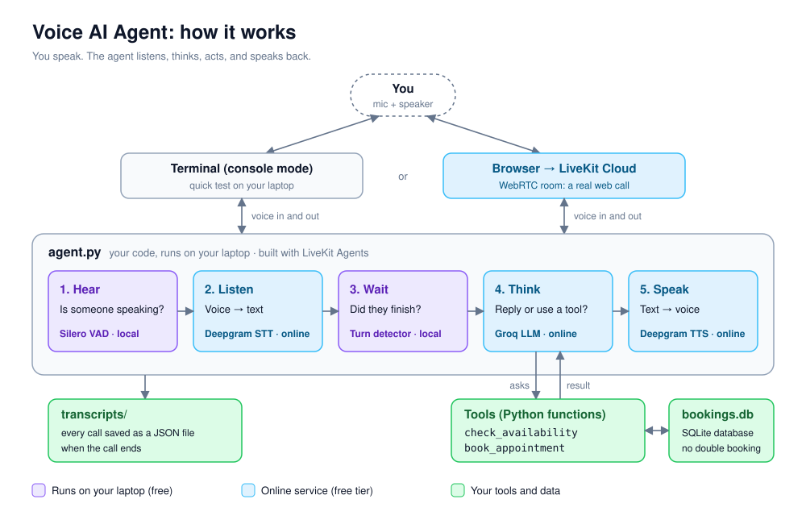

# 🎙️ Voice AI Agent: "Maya" the receptionist

Talk to it like a phone call. Say *"I want an appointment on Friday"* and Maya checks the free times, books one for you, and saves it.

A learning project built with **free services only**.



## How one turn of the conversation works

1. **Hear:** Silero notices you are speaking
2. **Listen:** Deepgram turns your voice into text
3. **Wait:** the turn detector checks that you finished your sentence
4. **Think:** Groq writes a reply, or uses a tool (check free slots, book)
5. **Speak:** Deepgram turns the reply into a voice you hear

This repeats until you say bye.

## Tech stack

| Part | Tool | Cost |
|---|---|---|
| Voice agent framework | LiveKit Agents (Python) | Free, open source |
| Voice rooms for browser calls | LiveKit Cloud | Free plan |
| Speech to text, text to speech | Deepgram | Free credit |
| LLM brain | Groq | Free tier |
| Voice and turn detection | Silero, LiveKit turn detector | Free, runs on your laptop |
| Database | SQLite | Free, built into Python |

## Project structure

```
voice-ai-agent/
├── agent.py          the voice agent: listen → think → speak, plus tools
├── db.py             the bookings database: free slots, booking rules, no double booking
├── requirements.txt  the Python packages to install
├── .env.example      the API keys you need (copy it to .env)
├── .env              your API keys (secret, never uploaded)
├── docs/             project intro and diagram
└── transcripts/      a saved transcript of every call (not uploaded)
```

## How to run

**You need:** Python 3.10 to 3.15, a microphone, and 3 free accounts:

| Service | What it's for | Get a free key |
|---|---|---|
| LiveKit Cloud | Voice rooms for browser calls | [cloud.livekit.io](https://cloud.livekit.io) → your project → Settings → API keys |
| Deepgram | Speech to text, text to speech | [console.deepgram.com](https://console.deepgram.com) |
| Groq | The LLM brain | [console.groq.com/keys](https://console.groq.com/keys) |

On Linux, the terminal mode also needs the audio library: `sudo apt install libportaudio2`

**1. Set up (first time only)**

```bash
python3 -m venv .venv
source .venv/bin/activate
pip install -r requirements.txt
cp .env.example .env              # then put your own free keys in .env
python agent.py download-files    # downloads the voice and turn-detection models
```

**2. Talk to Maya**

```bash
source .venv/bin/activate
python agent.py console           # talk in the terminal
python agent.py dev               # talk in the browser (LiveKit Agent Console)
```

## Booking rules

- Open Monday to Saturday at 10:00, 11:30, 14:00, 15:30 and 17:00
- No bookings on past days, for times that already passed today, or on Sundays
- One booking per time slot (no double booking)
- These rules live in `db.py`, so the AI can't break them

## How to test

### Option A: in the terminal (quickest)

```bash
python agent.py console
```

Maya greets you through your speakers. Talk into your microphone.
No microphone? Press **Ctrl+T** to switch to text mode and type instead.
Press **Ctrl+C** to quit.

### Option B: in the browser (a real voice call)

1. Start the agent and leave this terminal open:
   ```bash
   python agent.py dev
   ```
   Wait until you see `registered worker` in the log.
2. Open [cloud.livekit.io](https://cloud.livekit.io) → your project → **Agents** → **Console**
   (or go to [agents-playground.livekit.io](https://agents-playground.livekit.io), which opens the same page).
3. Click **Connect** and allow the microphone. Maya says hello.

### What to say, and what Maya should do

| You say | Maya should |
|---|---|
| "I want an appointment next Monday." | Check the database and offer only the free times |
| "Eleven thirty." | Ask for your name |
| "My name is Riya." | Repeat the day, time and name back, then wait |
| "Yes, that's correct." | Book it and give you a booking number |
| "That's all, bye." | Say goodbye and end the call by herself |
| *New call:* "Next Monday at eleven thirty?" | Say it's taken and offer other times (no double booking) |
| "Can I book on Sunday?" | Say the clinic is closed on Sundays |
| "Can I come today?" | Offer only the times that haven't passed yet |

Tip: wait for Maya to finish speaking before you talk. If you talk over her, she stops and listens.

### Check the results

See every booking in the database:

```bash
python -c "import sqlite3; [print(r) for r in sqlite3.connect('bookings.db').execute('SELECT * FROM bookings')]"
```

Read the transcript of each call. There is one file per call, with the tools Maya used:

```bash
ls transcripts/
cat transcripts/*.txt
```

Start again with an empty database (it is recreated on the next call):

```bash
rm bookings.db
```

### If something goes wrong

| Problem | Fix |
|---|---|
| `401` or `Unauthorized` | A LiveKit key or secret is wrong. Copy it again with the dashboard's copy button, with no extra characters |
| `429` or `rate limit` | Groq's free plan allows a limited number of words per minute. Wait 1 minute |
| `GROQ_API_KEY is required` | `.env` is missing. Run `cp .env.example .env` in the project folder and add your keys |
| Terminal mode can't find a microphone (Linux) | `sudo apt install libportaudio2` |
| The browser connects but Maya never speaks | `python agent.py dev` must be running, with `registered worker` in the log |
| Maya mishears your name | Spell it: "It's Riya, R-I-Y-A". That's why she repeats the details back |

## Progress

- [x] Step 1: Python setup
- [x] Step 2: API keys
- [x] Step 3: An agent that can talk
- [x] Step 4: Database
- [x] Step 5: Tools (check slots, book)
- [x] Step 6: Talk in the browser
- [x] Step 7: Save call transcripts
- [x] Step 8: Publish on GitHub

📖 More details: [docs/project-intro.md](docs/project-intro.md)
