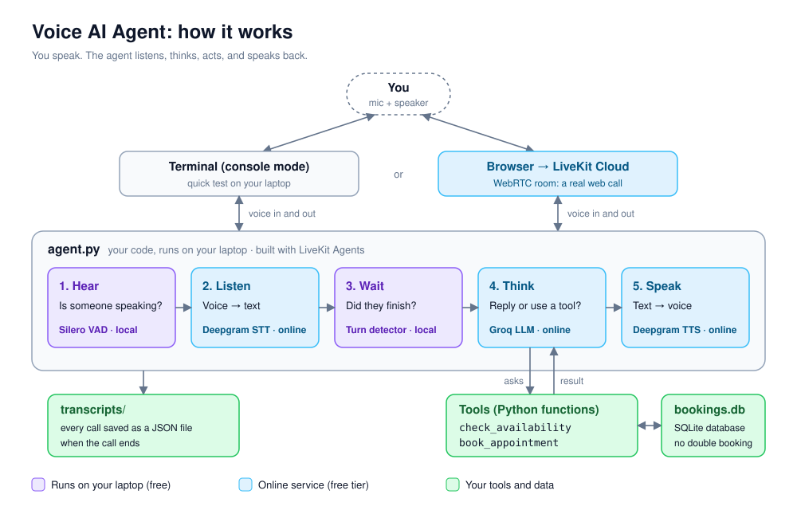

# Project intro: Voice AI Agent

## What is it?

An AI receptionist you talk to with your voice. Her name is **Maya** and she books appointments for a dental clinic ("Smile Dental"). To use it for another business, change Maya's instructions (the prompt).



## Architecture: a cascaded voice pipeline

Your voice passes through separate parts, **one after another, like a relay race**. Each part does one job and hands the result to the next.

The project has 3 layers:

| Layer | Its job | In this project |
|---|---|---|
| 1. Transport | Carries your voice in and Maya's voice out | Terminal (console mode), or browser → LiveKit Cloud (WebRTC) |
| 2. Voice pipeline | Hear → listen → wait → think → speak | `agent.py` with Silero, Deepgram, the turn detector and Groq |
| 3. Actions | Does real work | Tools → `db.py` → `bookings.db` |

## Each part in one line

| Part | Simple meaning | Example |
|---|---|---|
| Silero VAD | "Is someone speaking?" | Ignores silence and background noise |
| Deepgram STT | Ears: voice → text | Your voice → "Any slot on Friday?" |
| Turn detector | "Did they finish their sentence?" | Waits if you pause in the middle |
| Groq LLM | Brain: reply, or use a tool | Decides to call `check_availability` |
| Tools | Python functions the LLM can call | `check_availability`, `book_appointment` |
| SQLite | A database stored in one file | Saves bookings, blocks double booking |
| Deepgram TTS | Mouth: text → voice | "I have two PM or five PM" |
| LiveKit Cloud | A private voice room for browser calls | Browser and agent join the same room |

## Example conversation

```
You:   "Any slot on Friday?"
         → Groq uses check_availability("2026-11-27")
         → bookings.db: 10:00, 11:30, 14:00, 15:30, 17:00
Maya:  "I have ten, eleven thirty, two, three thirty or five. Which works?"
You:   "Two PM. My name is Riya."
         → Groq uses book_appointment("Riya", "2026-11-27", "14:00")
         → bookings.db saves booking #1
Maya:  "You're booked for Friday at two PM."
```

## Why this architecture?

| Cascaded pipeline (this project) | Speech-to-speech (one big model) |
|---|---|
| Free services are available | Usually paid |
| You can see the text at every step, so it's easy to debug | Hard to see what went wrong |
| You can swap any part (for example, another LLM) | One model, nothing to swap |
| A little slower (more steps) | Slightly faster |

## Not included yet

- **Phone number:** costs money. The agent code would stay the same.
- **Own web page with a Talk button:** for now, the LiveKit Playground is used to talk in the browser.
